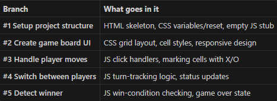

# Tic Tac Toe

A simple, browser-based Tic Tac Toe game for two players. Players take turns
placing X and O on a 3 × 3 board. The game announces a winner when a player
gets three marks in a row, column, or diagonal, and reports a draw if the
board fills up without a winner. Start a new round at any time with the
**Restart Game** button.

## Run the game

Open `frontend/index.html` in a web browser. No installation or build step is
needed.

## Project structure

- `frontend/index.html` — game page and board
- `frontend/style.css` — layout and visual styles
- `frontend/script.js` — turn handling, win detection, and restart logic

